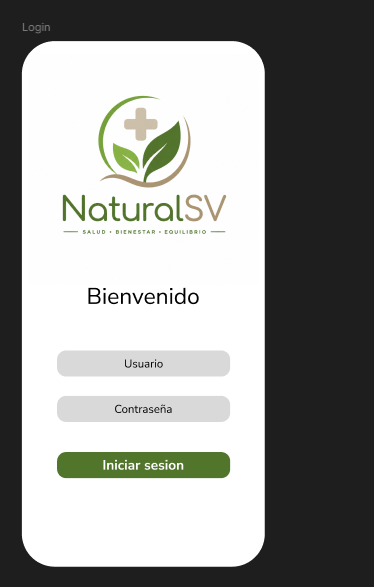

## Videos de Avance

* **Video Fase 1 / Demo:** https://drive.google.com/file/d/1Y4YJlsh_NA2g94SjwPMgjjGyGYgaZ36T/view?usp=sharing[cite: 13]
Avanze fase 2 video
https://udbedu-my.sharepoint.com/:p:/g/personal/as230282_alumno_udb_edu_sv/IQAnDTJnrbleT6_PlJjz_dCpAYicSsewur3Hh8Z8xlW4BHQ?rtime=XW1U-Bw-30g
## Mockups (Diseño Figma)

| Inicio de Sesión | Menú Principal |
| :---: | :---: |
|  |  |

| Gestión de Clientes | Gestión de Productos |
| :---: | :---: |
|  |  |

| Gestión de Compras | Gestión de Usuarios |
| :---: | :---: |
|  |  |

## Funcionalidades Principales

* **Autenticación Multiplataforma (Firebase Auth):**
  * Inicio de sesión con correo electrónico y contraseña con persistencia local mediante `AsyncStorage`.
  * Inicio de sesión con Google (OAuth mediante `signInWithPopup` en web y flujo controlado en Expo Go).
* **Módulos Operativos:** CRUD completo para **Clientes**, **Compras**, **Productos** e **Inventario**, y **Usuarios**.
* **Sincronización en Tiempo Real:** Conexión compartida con **Cloud Firestore** entre la app móvil y la versión web.

## Instalación y Ejecución

1. Instalar dependencias:
   ```bash
   npm install
2. Iniciar el servidor de desarrollo:
   npx expo start
   