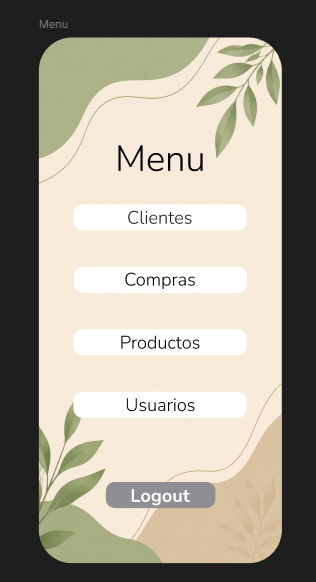
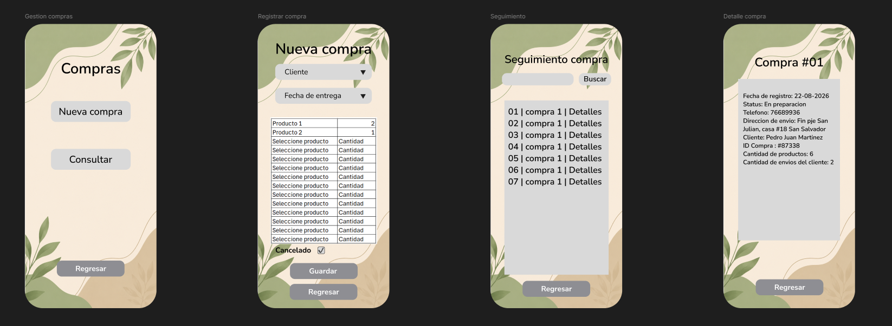

## Videos de Avance

* **Video Fase 1 / Demo:** https://drive.google.com/file/d/1Y4YJlsh_NA2g94SjwPMgjjGyGYgaZ36T/view?usp=sharing[cite: 13]
Avanze fase 2 video
https://udbedu-my.sharepoint.com/:p:/g/personal/as230282_alumno_udb_edu_sv/IQAnDTJnrbleT6_PlJjz_dCpAYicSsewur3Hh8Z8xlW4BHQ?rtime=XW1U-Bw-30g

Avance Etapa FINAL 3 
https://udbedu-my.sharepoint.com/:p:/g/personal/as230282_alumno_udb_edu_sv/IQAnDTJnrbleT6_PlJjz_dCpAYicSsewur3Hh8Z8xlW4BHQ?rtime=_tXvc0RM30g
Enlace con presentación y explicación por parte de cada integrante sobre funcionamiento de la aplicación.

## Mockups (Diseño Figma)

| Inicio de Sesión | Menú Principal |
| :---: | :---: |
|  |  |

| Gestión de Clientes | Gestión de Productos |
| :---: | :---: |
|  |  |

| Gestión de Compras | Gestión de Usuarios |
| :---: | :---: |
|  |  |

## Funcionalidades Principales

* **Autenticación Multiplataforma (Firebase Auth):**
  * Inicio de sesión con correo electrónico y contraseña con persistencia local mediante `AsyncStorage`.
  * Inicio de sesión con Google (OAuth mediante `signInWithPopup` en web y flujo controlado en Expo Go).
* **Módulos Operativos:** CRUD completo para **Clientes**, **Compras**, **Productos** e **Inventario**, y **Usuarios**.
* **Sincronización en Tiempo Real:** Conexión compartida con **Cloud Firestore** entre la app móvil y la versión web.

## Instalación y Ejecución

1. Instalar dependencias:
   ```bash
   npm install
2. Iniciar el servidor de desarrollo:
   npx expo start
<<<<<<< HEAD
   
=======
   ```

In the output, you'll find options to open the app in a

- [development build](https://docs.expo.dev/develop/development-builds/introduction/)
- [Android emulator](https://docs.expo.dev/workflow/android-studio-emulator/)
- [iOS simulator](https://docs.expo.dev/workflow/ios-simulator/)
- [Expo Go](https://expo.dev/go), a limited sandbox for trying out app development with Expo

You can start developing by editing the files inside the **app** directory. This project uses [file-based routing](https://docs.expo.dev/router/introduction).

## Get a fresh project

When you're ready, run:

```bash
npm run reset-project
```

This command will move the starter code to the **app-example** directory and create a blank **app** directory where you can start developing.

### Other setup steps

- To set up ESLint for linting, run `npx expo lint`, or follow our guide on ["Using ESLint and Prettier"](https://docs.expo.dev/guides/using-eslint/)
- If you'd like to set up unit testing, follow our guide on ["Unit Testing with Jest"](https://docs.expo.dev/develop/unit-testing/)
- Learn more about the TypeScript setup in this template in our guide on ["Using TypeScript"](https://docs.expo.dev/guides/typescript/)

## Learn more

To learn more about developing your project with Expo, look at the following resources:

- [Expo documentation](https://docs.expo.dev/): Learn fundamentals, or go into advanced topics with our [guides](https://docs.expo.dev/guides).
- [Learn Expo tutorial](https://docs.expo.dev/tutorial/introduction/): Follow a step-by-step tutorial where you'll create a project that runs on Android, iOS, and the web.

## Join the community

Join our community of developers creating universal apps.

- [Expo on GitHub](https://github.com/expo/expo): View our open source platform and contribute.
- [Discord community](https://chat.expo.dev): Chat with Expo users and ask questions.

## Compras integradas con Firebase (Fase 3)

El módulo de compras registra, edita y elimina en Firestore `purchases` con `userId`,
`creadoEn: serverTimestamp()` y escucha en tiempo real `onSnapshot`.
La ruta `src/app/compras.tsx` reutiliza `src/screen/ComprasScreen.tsx`.
Ver `docs/GUIA-JOSE-DEFENSA.md` para pruebas y defensa, y la integración
web en https://github.com/contreraaaa/Natural-SV.
>>>>>>> 3e76e4d3a2adb18d25e4c6628bfbccaafcd714c9
